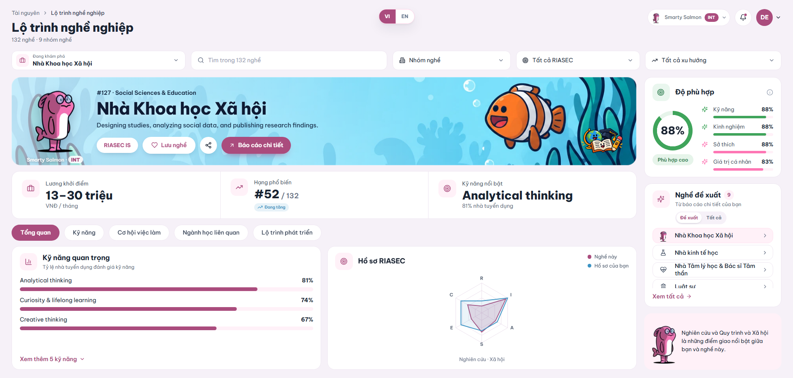
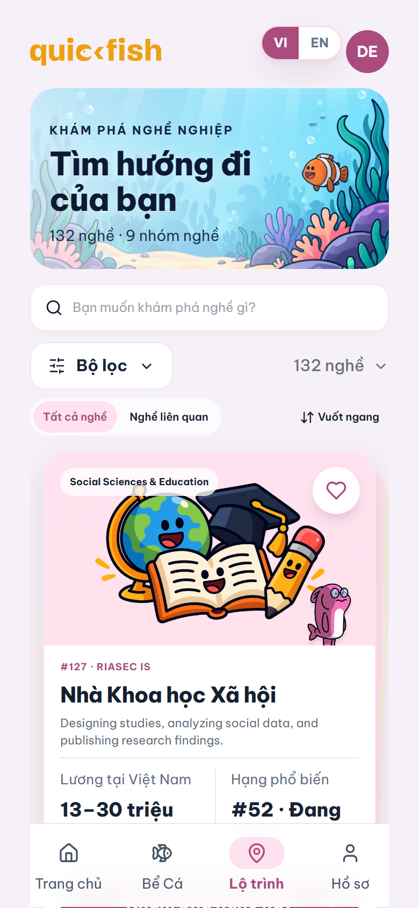

# QuickFish — Career Path V2

The career-path dashboard the team picked (V2), packaged as a standalone Next.js demo so it can be reviewed and then
moved into `quickfish-frontend-nextjs`. Web is a one-screen dashboard; phones get a swipe deck.

| Desktop | Mobile |
| --- | --- |
|  |  |

Fish themes recolour the whole page (`docs/fish/`). English: `docs/desktop-en.png`.

## Run it

```bash
npm install
npm run dev          # http://localhost:4050
```

- `?lang=en`: English (default is Vietnamese).
- `?guest=1`: signed-out state (no fish, no fit score, no recommendations).
- `?career=<slug>`: open a specific career, e.g. `?career=lawyers`.
- Phone layout: open DevTools → device toolbar, or make the window narrower than 900 px.

`npm test` checks the data JSON and header logic (11 tests). `npx tsc --noEmit` type-checks.

## Where the data comes from

**Read `data/QuickFish_CareerPath_V2_DataMap.xlsx` first.** It lists every UI element, the sheet column behind it,
the rule applied, the JSON field and the code that renders it.

```
data/ALLJOBs_slim.xlsx  ──(npm run import:sheet)──▶  public/data/career-dashboard.v1.json  ──fetch──▶  dashboard
QuickFish backend (per user): fish, RIASEC scores, recommended jobs, detail report PDF, saved careers
```

- Update careers: replace `data/ALLJOBs_slim.xlsx`, run `npm run import:sheet` (Python 3 + `openpyxl`),
  then `npm test`.
- Rebuild the data map after a sheet change: `python scripts/build-data-map.py`.
- Nothing outside the sheet and the backend is shown. A field the sheet doesn't have stays empty.

## What is real and what is stubbed in this demo

| In this repo | In the real app |
| --- | --- |
| `src/core/providers/AuthProvider.tsx` returns `src/demo/demo-user.json` | the app's own `AuthProvider` (`/api/auth/profile/`) |
| `src/core/repositories/abstract-repository.ts` stores saved careers in `localStorage` | the app's `AbstractRepository` → `GET/POST /api/auth/profile/saved-careers/` |
| `src/components/survey-history/repositories/detail-reported.ts` returns `public/sample/detail-report-sample.pdf` | the app's `DetailReportedRepository` → `POST /api/survey/report/generate/<survey_id>/` |
| `src/stubs/next-intl.ts` reads `?lang=` | `next-intl` from the `/[locale]` route |
| `src/app/LocaleToggle.tsx`, `src/app/page.tsx` | not needed; demo shell only |

Everything in `src/features/career-dashboard/` is the production code. It imports the stubbed files using the
same paths and names as the app, so it drops in unchanged.

## Moving it into `quickfish-frontend-nextjs`

1. Copy `src/features/career-dashboard/` into the app at the same path. Copy `public/data/career-dashboard.v1.json`
   and `public/assets/{career-dashboard,career-deck,career-path-v3,fishes}` into `public/`.
2. Page `src/app/[locale]/career-path/page.tsx`, inside the app's sidebar layout:
   ```tsx
   import CareerDashboard from "@/features/career-dashboard/CareerDashboard";
   export default function Page() {
       return <div className="qf-career-host"><CareerDashboard /></div>;
   }
   ```
   `.qf-career-host` must fill the content area. The dashboard scales itself to fit one screen on desktop.
3. The dashboard reads `user.latest_survey` (`fish_type`, `riasec_scores`, `job_top_5`, `job_zone_rec`, `id`).
   These fields already exist in the app's `LatestSurvey` model (`src/core/models`).
4. Add `@radix-ui/react-dialog` if the app doesn't have it. Everything else is already in the app.
5. Backend: apply `backend/saved-careers.patch` to `quickfish-backend` (`user/models.py`, `user/urls.py`,
   `user/views.py`), then run `python manage.py makemigrations user && python manage.py migrate`.
   This adds `GET/POST/DELETE /api/auth/profile/saved-careers/` (per-user, unique by `career_slug`).

## Open points for review

- **Report-name crosswalk** (`report-recommendations.ts`, sheet `Report_crosswalk`): 51 hand-made links from
  survey report job names to sheet careers. Please review them. Report jobs with no match don't
  appear in the recommendations list.
- **Fit bars** (right rail): the 4 bars are views of one RIASEC fit score (`Giá trị cá nhân` = score × 0.94).
  They are not separate measurements.
- **`day_to_day`** is English only in the sheet, so the Vietnamese UI shows English descriptions.
- **`stage_skills`** has 4 groups for 5 path steps, so step 4 has no skills listed.
